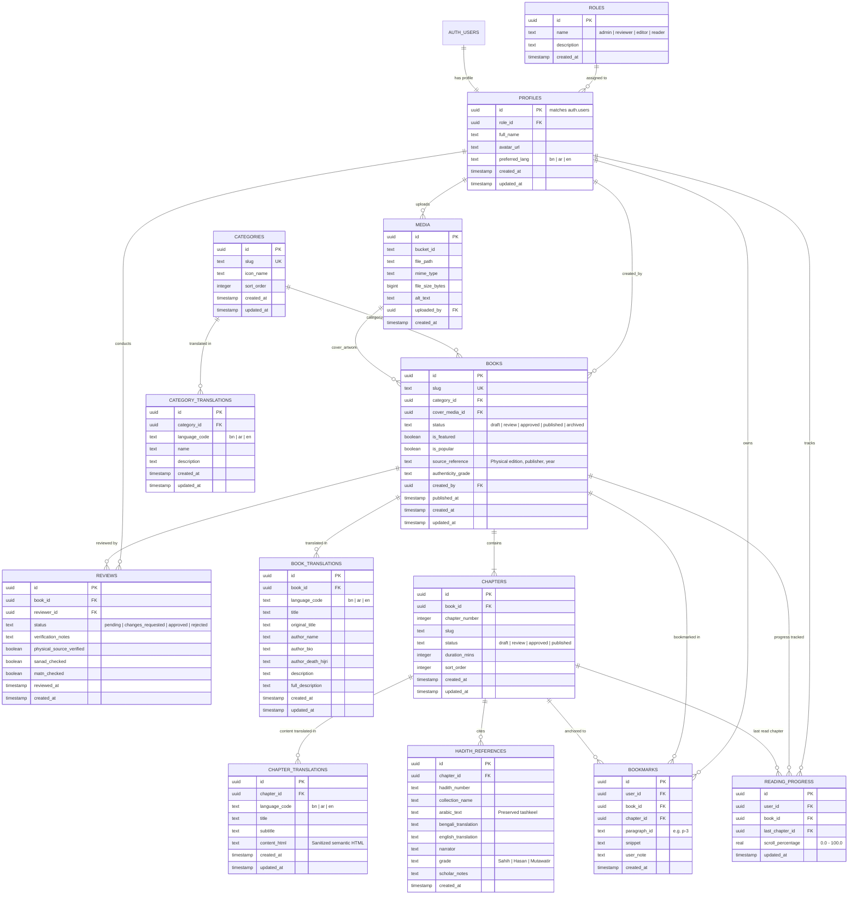

# Protidiner Sunnah (প্রতিদিনের সুন্নাহ)
## Normalized Relational Database Architecture & Setup Guide

> **Database:** Supabase PostgreSQL  
> **Security:** Strict Row Level Security (RLS) & Role-Based Access Control (RBAC)  
> **Integrity Guard:** Normalized multi-language tables, unique constraints, and physical source verification audits.

---

## 1. Architectural Normalization Rationale

To deliver a scalable, enterprise-grade multilingual Islamic digital library with absolute textual integrity, the database is structured into **13 normalized tables**:

1. **Entity-Translation Separation**:
   - `categories` and `category_translations`
   - `books` and `book_translations`
   - `chapters` and `chapter_translations`
   *Why:* Keeps language-independent metadata (slugs, sort orders, status, creation timestamps, covers) separated from localized text. Adding new translations never alters core entities, and `UNIQUE(entity_id, language_code)` ensures zero duplicate translations.
2. **Dedicated Hadith Reference Repository (`hadith_references`)**:
   - Separates prophetic traditions and Quranic texts from chapter markup.
   - Preserves classical Arabic with full diacritics (*Tashkeel*), English/Bengali translations, exact canonical numbers, and scholarly authentication grades (*Sahih*, *Hasan*, *Mutawatir*).
3. **Scholar Audit & Editorial Review System (`reviews`)**:
   - Tracks reviewing scholars, physical manuscript audits, Sanad check confirmation, and Matn audit remarks before any book transitions from `review` to `published`.
4. **Isolated Personal Reader Data (`bookmarks`, `reading_progress`)**:
   - Enforces strict tenant isolation via RLS policies (`auth.uid() = user_id`).

---

## 2. Entity-Relationship Diagram (ERD)



---

## 3. Row Level Security (RLS) Permissions Matrix

| Table | Public Readers (Anon) | Authenticated Readers | Reviewers | Administrators |
| :--- | :---: | :---: | :---: | :---: |
| `roles` | Read-only | Read-only | Read-only | Full Access |
| `profiles` | Read-only | Read & Edit Own Profile | Read & Edit Own Profile | Full Access |
| `categories` & translations | Read-only | Read-only | Read-only | Full Access |
| `books` & translations | Read (Published only) | Read (Published only) | Read (All draft/review/published) | Full Access (Create, Edit, Publish) |
| `chapters` & translations | Read (Published only) | Read (Published only) | Read (All draft/review/published) | Full Access (Create, Edit, Publish) |
| `hadith_references` | Read (Published chapters) | Read (Published chapters) | Read & Audit | Full Access |
| `bookmarks` | No access | Manage Own Only (`auth.uid() = user_id`) | Manage Own Only | Manage Own Only |
| `reading_progress` | No access | Manage Own Only (`auth.uid() = user_id`) | Manage Own Only | Manage Own Only |
| `reviews` | No access | No access | Insert & View Reviews | Full Access & Override |
| `media` | Read-only | Read-only | Upload & View | Full Access |

---

## 4. Environment Variables Configuration

In `.env.local` (or production environment settings), define the following variables:

```bash
# Public Client Keys (Safe to expose to browser)
NEXT_PUBLIC_SUPABASE_URL=https://your-project-id.supabase.co
NEXT_PUBLIC_SUPABASE_ANON_KEY=eyJhbGciOiJIUzI1NiIsInR5cCI6IkpXVCJ9...

# Backend Secret Role Key (NEVER expose to client/browser, server-side only)
SUPABASE_SERVICE_ROLE_KEY=eyJhbGciOiJIUzI1NiIsInR5cCI6IkpXVCJ9...

# Application Configuration
NEXT_PUBLIC_SITE_URL=http://localhost:3000
NEXT_PUBLIC_DEFAULT_LOCALE=bn
```

> [!CAUTION]
> **Secret Key Protection**:
> `SUPABASE_SERVICE_ROLE_KEY` bypasses all Row Level Security policies. It is **never** bundled into Next.js client bundles, never prefixed with `NEXT_PUBLIC_`, and only used in isolated administrative server actions or maintenance scripts.

---

## 5. Migration Deployment Steps

### Option A: Via Supabase Web Dashboard
1. Open your Supabase Project at [https://supabase.com/dashboard](https://supabase.com/dashboard).
2. Navigate to **SQL Editor** in the left sidebar.
3. Click **New Query**.
4. Open the migration file [`supabase/migrations/20261112_normalized_schema.sql`](file:///d:/Ebook/supabase/migrations/20261112_normalized_schema.sql).
5. Copy its complete contents, paste into the SQL Editor, and click **Run**.

### Option B: Via Supabase CLI
```bash
# Link your local project to your remote Supabase instance
npx supabase link --project-ref your-project-id

# Push and execute the migration
npx supabase db push
```

---

## 6. Verification Checklist After Migration

- [ ] All 13 tables are listed in the `public` schema.
- [ ] RLS is enabled on all 13 tables (indicated by a lock icon in Supabase table view).
- [ ] Default roles (`admin`, `reviewer`, `editor`, `reader`) are seeded in `public.roles`.
- [ ] The trigger `on_auth_user_created` successfully inserts a profile for new signups.
- [ ] Test query as unauthenticated user returns only rows where `status = 'published'`.
