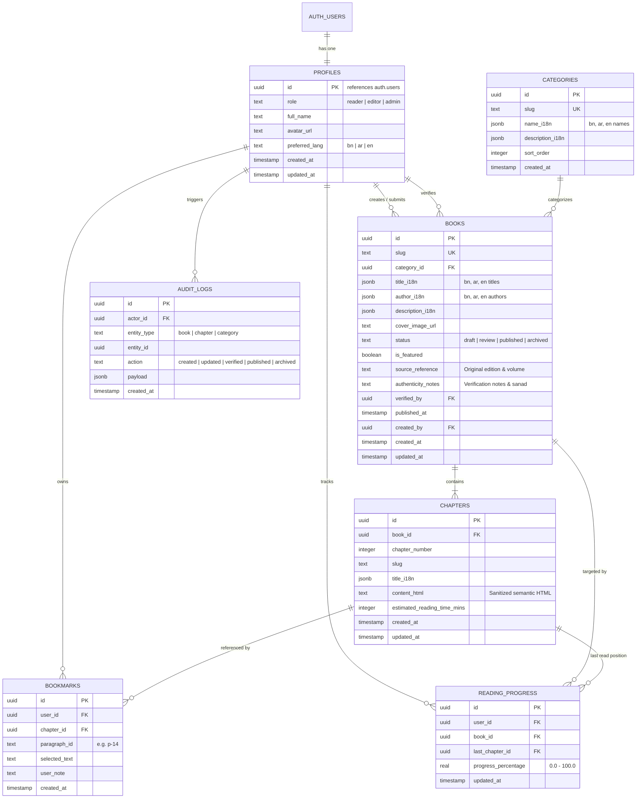

# Protidiner Sunnah (প্রতিদিনের সুন্নাহ)
## Database Design & Security Specification

> **Platform:** Supabase PostgreSQL  
> **Security Model:** Strict Role-Based Row Level Security (RLS)  
> **Integrity Guard:** Mandatory scholar audit trail and zero unverified publications.

---

## 1. Entity-Relationship Diagram (ERD)



---

## 2. Table Specifications & Data Dictionaries

### 2.1 `public.profiles`
Stores user profile information, role-based authorization levels, and default localization settings.

| Column | Type | Constraints | Description |
| :--- | :--- | :--- | :--- |
| `id` | `uuid` | `PRIMARY KEY`, references `auth.users(id)` ON DELETE CASCADE | Matches Supabase Auth user ID |
| `role` | `text` | `NOT NULL`, `CHECK (role IN ('reader', 'editor', 'admin'))`, default `'reader'` | Role for RBAC permissions |
| `full_name` | `text` | Nullable | User's display name |
| `avatar_url`| `text` | Nullable | User's profile image |
| `preferred_lang` | `text` | `CHECK (preferred_lang IN ('bn', 'ar', 'en'))`, default `'bn'` | UI language preference |
| `created_at` | `timestamptz` | `NOT NULL`, default `timezone('utc', now())` | Record creation timestamp |
| `updated_at` | `timestamptz` | `NOT NULL`, default `timezone('utc', now())` | Record update timestamp |

---

### 2.2 `public.categories`
Multilingual classifications for literature (e.g., Aqeedah, Hadith, Fiqh, Seerah, Duas).

| Column | Type | Constraints | Description |
| :--- | :--- | :--- | :--- |
| `id` | `uuid` | `PRIMARY KEY`, default `uuid_generate_v4()` | Unique category identifier |
| `slug` | `text` | `UNIQUE`, `NOT NULL` | URL-friendly slug (e.g. `hadith-collections`) |
| `name_i18n` | `jsonb` | `NOT NULL` | JSON object: `{"bn": "...", "ar": "...", "en": "..."}` |
| `description_i18n` | `jsonb` | default `'{}'::jsonb` | Localized category descriptions |
| `sort_order` | `integer` | default `0` | Display sorting priority |
| `created_at` | `timestamptz` | `NOT NULL`, default `timezone('utc', now())` | Creation timestamp |

---

### 2.3 `public.books`
The core catalog item representing an Islamic book or treatise.

| Column | Type | Constraints | Description |
| :--- | :--- | :--- | :--- |
| `id` | `uuid` | `PRIMARY KEY`, default `uuid_generate_v4()` | Unique book identifier |
| `slug` | `text` | `UNIQUE`, `NOT NULL` | URL slug (e.g. `riyad-us-saliheen`) |
| `category_id` | `uuid` | `REFERENCES public.categories(id)` ON DELETE SET NULL | Associated topic category |
| `title_i18n` | `jsonb` | `NOT NULL` | Localized book titles |
| `author_i18n` | `jsonb` | `NOT NULL` | Localized author names |
| `description_i18n` | `jsonb` | `NOT NULL` | Localized synopses |
| `cover_image_url` | `text` | Nullable | Supabase CDN URL for cover artwork |
| `status` | `text` | `NOT NULL`, `CHECK (status IN ('draft', 'review', 'published', 'archived'))`, default `'draft'` | Publishing workflow lifecycle status |
| `is_featured` | `boolean` | default `false` | Highlighted on homepage hero |
| `source_reference` | `text` | Nullable | Classical edition, publisher, volume, year |
| `authenticity_notes` | `text` | Nullable | Verification methodology and notes |
| `verified_by` | `uuid` | `REFERENCES public.profiles(id)` | Scholar/Admin ID who approved text |
| `published_at` | `timestamptz`| Nullable | Timestamp when published live |
| `created_by` | `uuid` | `REFERENCES public.profiles(id)` | Author/Editor who submitted text |
| `created_at` | `timestamptz`| `NOT NULL`, default `timezone('utc', now())` | Creation timestamp |
| `updated_at` | `timestamptz`| `NOT NULL`, default `timezone('utc', now())` | Last update timestamp |

---

### 2.4 `public.chapters`
Contains the structured HTML reading content for each section or chapter.

| Column | Type | Constraints | Description |
| :--- | :--- | :--- | :--- |
| `id` | `uuid` | `PRIMARY KEY`, default `uuid_generate_v4()` | Unique chapter identifier |
| `book_id` | `uuid` | `NOT NULL`, `REFERENCES public.books(id)` ON DELETE CASCADE | Parent book |
| `chapter_number` | `integer` | `NOT NULL` | Sequential order within the book |
| `slug` | `text` | `NOT NULL` | Chapter slug (e.g. `chapter-1-sincerity`) |
| `title_i18n` | `jsonb` | `NOT NULL` | Localized chapter headings |
| `content_html` | `text` | `NOT NULL` | Sanitized, semantic HTML chapter body |
| `estimated_reading_time_mins` | `integer` | default `5` | Computed reading duration |
| `created_at` | `timestamptz`| `NOT NULL`, default `timezone('utc', now())` | Creation timestamp |
| `updated_at` | `timestamptz`| `NOT NULL`, default `timezone('utc', now())` | Last update timestamp |

*Unique Constraints*: `UNIQUE(book_id, chapter_number)` and `UNIQUE(book_id, slug)`.

---

### 2.5 `public.bookmarks`
Personalized bookmarks anchored to individual chapters or specific paragraphs.

| Column | Type | Constraints | Description |
| :--- | :--- | :--- | :--- |
| `id` | `uuid` | `PRIMARY KEY`, default `uuid_generate_v4()` | Bookmark identifier |
| `user_id` | `uuid` | `NOT NULL`, `REFERENCES public.profiles(id)` ON DELETE CASCADE | Owner reader |
| `chapter_id` | `uuid` | `NOT NULL`, `REFERENCES public.chapters(id)` ON DELETE CASCADE | Bookmarked chapter |
| `paragraph_id` | `text` | Nullable | DOM paragraph anchor (`p-12`) |
| `selected_text` | `text` | Nullable | Highlighted quotation snippet |
| `user_note` | `text` | Nullable | Personal reflection note |
| `created_at` | `timestamptz`| `NOT NULL`, default `timezone('utc', now())` | Timestamp saved |

---

### 2.6 `public.reading_progress`
Tracks reading completion percentage and bookmark continuity across user devices.

| Column | Type | Constraints | Description |
| :--- | :--- | :--- | :--- |
| `id` | `uuid` | `PRIMARY KEY`, default `uuid_generate_v4()` | Unique progress record |
| `user_id` | `uuid` | `NOT NULL`, `REFERENCES public.profiles(id)` ON DELETE CASCADE | Owner reader |
| `book_id` | `uuid` | `NOT NULL`, `REFERENCES public.books(id)` ON DELETE CASCADE | Tracked book |
| `last_chapter_id` | `uuid` | `REFERENCES public.chapters(id)` ON DELETE SET NULL | Last accessed chapter |
| `progress_percentage` | `real` | default `0.0`, `CHECK (progress_percentage BETWEEN 0.0 AND 100.0)` | Completion percentage |
| `updated_at` | `timestamptz`| `NOT NULL`, default `timezone('utc', now())` | Last activity timestamp |

*Unique Constraint*: `UNIQUE(user_id, book_id)`.

---

### 2.7 `public.audit_logs`
Immutable audit trail recording every state change, verification approval, and publication event.

| Column | Type | Constraints | Description |
| :--- | :--- | :--- | :--- |
| `id` | `uuid` | `PRIMARY KEY`, default `uuid_generate_v4()` | Log identifier |
| `actor_id` | `uuid` | `REFERENCES public.profiles(id)` ON DELETE SET NULL | User who triggered the action |
| `entity_type` | `text` | `NOT NULL` | `'book'`, `'chapter'`, `'category'` |
| `entity_id` | `uuid` | `NOT NULL` | ID of modified entity |
| `action` | `text` | `NOT NULL` | `'created'`, `'updated'`, `'verified'`, `'published'` |
| `payload` | `jsonb` | default `'{}'::jsonb` | Diff / snapshot data |
| `created_at` | `timestamptz`| `NOT NULL`, default `timezone('utc', now())` | Action timestamp |

---

## 3. Row Level Security (RLS) Strategy & Policies

### 3.1 Security Matrix
| Table | Public (Anon) | Authenticated Reader | Editor | Admin |
| :--- | :---: | :---: | :---: | :---: |
| `profiles` | Read-only | Read & Edit Own | Read & Edit Own | Full Access |
| `categories` | Read-only | Read-only | Create / Edit | Full Access |
| `books` | Read (Published only) | Read (Published only) | Read All / Create / Edit Drafts | Full Access & Publish |
| `chapters` | Read (Published only) | Read (Published only) | Read All / Create / Edit Drafts | Full Access & Publish |
| `bookmarks` | No access | Full Access (Own only) | Full Access (Own only) | Full Access (Own only) |
| `reading_progress` | No access | Full Access (Own only) | Full Access (Own only) | Full Access (Own only) |
| `audit_logs` | No access | No access | Read-only | Read-only |

### 3.2 SQL Policy Definitions

```sql
-- Profiles RLS
ALTER TABLE public.profiles ENABLE ROW LEVEL SECURITY;

CREATE POLICY "Public profiles are viewable by everyone"
  ON public.profiles FOR SELECT USING (true);

CREATE POLICY "Users can update their own profile"
  ON public.profiles FOR UPDATE USING (auth.uid() = id);

-- Categories RLS
ALTER TABLE public.categories ENABLE ROW LEVEL SECURITY;

CREATE POLICY "Categories viewable by public"
  ON public.categories FOR SELECT USING (true);

CREATE POLICY "Categories editable by editors and admins"
  ON public.categories FOR ALL USING (
    EXISTS (
      SELECT 1 FROM public.profiles 
      WHERE profiles.id = auth.uid() 
      AND profiles.role IN ('editor', 'admin')
    )
  );

-- Books RLS
ALTER TABLE public.books ENABLE ROW LEVEL SECURITY;

CREATE POLICY "Published books are viewable by public"
  ON public.books FOR SELECT
  USING (status = 'published');

CREATE POLICY "Staff can view all books"
  ON public.books FOR SELECT
  USING (
    EXISTS (
      SELECT 1 FROM public.profiles
      WHERE profiles.id = auth.uid()
      AND profiles.role IN ('editor', 'admin')
    )
  );

CREATE POLICY "Editors and admins can insert and update books"
  ON public.books FOR ALL
  USING (
    EXISTS (
      SELECT 1 FROM public.profiles
      WHERE profiles.id = auth.uid()
      AND profiles.role IN ('editor', 'admin')
    )
  );

-- Chapters RLS
ALTER TABLE public.chapters ENABLE ROW LEVEL SECURITY;

CREATE POLICY "Published chapters are viewable by public"
  ON public.chapters FOR SELECT
  USING (
    EXISTS (
      SELECT 1 FROM public.books
      WHERE books.id = chapters.book_id
      AND books.status = 'published'
    )
  );

CREATE POLICY "Staff can manage chapters"
  ON public.chapters FOR ALL
  USING (
    EXISTS (
      SELECT 1 FROM public.profiles
      WHERE profiles.id = auth.uid()
      AND profiles.role IN ('editor', 'admin')
    )
  );

-- Bookmarks RLS
ALTER TABLE public.bookmarks ENABLE ROW LEVEL SECURITY;

CREATE POLICY "Users can manage own bookmarks"
  ON public.bookmarks FOR ALL
  USING (auth.uid() = user_id);

-- Reading Progress RLS
ALTER TABLE public.reading_progress ENABLE ROW LEVEL SECURITY;

CREATE POLICY "Users can manage own progress"
  ON public.reading_progress FOR ALL
  USING (auth.uid() = user_id);
```

---

## 4. Performance Indexes & Optimizations

```sql
-- Foreign Key & Filter Indexes
CREATE INDEX IF NOT EXISTS idx_books_category ON public.books(category_id);
CREATE INDEX IF NOT EXISTS idx_books_status ON public.books(status);
CREATE INDEX IF NOT EXISTS idx_books_is_featured ON public.books(is_featured) WHERE is_featured = true;
CREATE INDEX IF NOT EXISTS idx_chapters_book_order ON public.chapters(book_id, chapter_number);
CREATE INDEX IF NOT EXISTS idx_bookmarks_user ON public.bookmarks(user_id);
CREATE INDEX IF NOT EXISTS idx_progress_user ON public.reading_progress(user_id, book_id);

-- Multilingual JSONB GIN Indexes (Fast Key & Value Search)
CREATE INDEX IF NOT EXISTS idx_books_title_gin ON public.books USING gin(title_i18n);
CREATE INDEX IF NOT EXISTS idx_books_author_gin ON public.books USING gin(author_i18n);
CREATE INDEX IF NOT EXISTS idx_categories_name_gin ON public.categories USING gin(name_i18n);
```

---

## 5. Automated Triggers & Auth Synchronization

### 5.1 Auto-create Profile on Signup
```sql
CREATE OR REPLACE FUNCTION public.handle_new_user()
RETURNS trigger AS $$
BEGIN
  INSERT INTO public.profiles (id, full_name, avatar_url, preferred_lang, role)
  VALUES (
    new.id,
    new.raw_user_meta_data->>'full_name',
    new.raw_user_meta_data->>'avatar_url',
    COALESCE(new.raw_user_meta_data->>'preferred_lang', 'bn'),
    'reader'
  );
  RETURN new;
END;
$$ LANGUAGE plpgsql SECURITY DEFINER;

CREATE OR REPLACE TRIGGER on_auth_user_created
  AFTER INSERT ON auth.users
  FOR EACH ROW EXECUTE FUNCTION public.handle_new_user();
```

### 5.2 Auto-update `updated_at` Timestamp
```sql
CREATE OR REPLACE FUNCTION public.set_updated_at()
RETURNS trigger AS $$
BEGIN
  new.updated_at = timezone('utc', now());
  RETURN new;
END;
$$ LANGUAGE plpgsql;

CREATE TRIGGER update_books_modtime
  BEFORE UPDATE ON public.books
  FOR EACH ROW EXECUTE FUNCTION public.set_updated_at();

CREATE TRIGGER update_chapters_modtime
  BEFORE UPDATE ON public.chapters
  FOR EACH ROW EXECUTE FUNCTION public.set_updated_at();
```

---

## 6. Supabase Storage Buckets
Two public/restricted buckets are configured:
1. `book-covers`: Public read CDN for WebP/AVIF cover artwork.
   * Max file size: 3MB
   * Allowed MIME types: `image/jpeg`, `image/png`, `image/webp`
   * Upload permission: Restricted to `admin` and `editor` roles via storage RLS.
2. `book-assets`: Internal storage for high-resolution manuscript scans and verification attachments.
   * Access: Restricted to authenticated staff.
