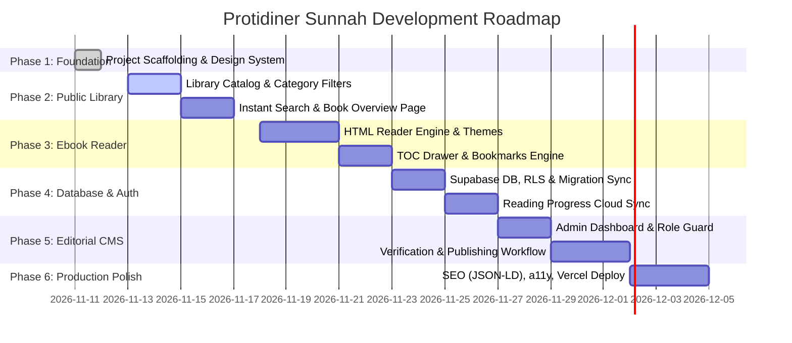

# Protidiner Sunnah (প্রতিদিনের সুন্নাহ)
## Phased Implementation Roadmap & Quality Assurance Plan

> **Methodology:** Incremental module-by-module delivery.  
> **Rule:** Every module is built, reviewed, tested, and verified before proceeding to the next.

---

## Roadmap Milestone Summary

---

## Phase Details & Deliverables

### Phase 1: Project Architecture & UI/UX Design System ✅ (Completed)
* **Deliverables:**
  * Next.js 14 App Router, TypeScript, Tailwind CSS scaffolding.
  * Islamic modern color tokens (`#123F35`, `#1B5547`, `#D9BD7A`, `#F7F1E5`, `#26332F`).
  * Multilingual typography stack (Bengali: Hind Siliguri; Arabic: Amiri; English: Inter).
  * Bi-directional RTL/LTR layout engine and instant Language Switcher.
  * Atomic UI primitives: [`Button`](file:///d:/Ebook/src/components/ui/button.tsx), [`Badge`](file:///d:/Ebook/src/components/ui/badge.tsx), [`Card`](file:///d:/Ebook/src/components/ui/card.tsx).
  * Global Header, Footer, and Landing page showcase.
* **QA & Verification Checkpoints:**
  * Clean TypeScript compilation with zero type errors.
  * Production build test (`npm run build`) exited with code 0.
  * Local Git repository initialized with initial clean commit.

---

### Phase 2: Multilingual Content & Public Library UI (Next Step)
* **Key Tasks:**
  * Build the public library catalog page (`/[lang]/library`).
  * Implement instant debounced search (matching title, author, and description).
  * Implement category filter tabs (Hadith, Fiqh, Seerah, Duas, etc.).
  * Build the Book Overview page (`/[lang]/books/[slug]`) displaying cover art, synopsis, table of contents, and scholar verification badge.
  * Provide verified classical starter dataset (*Riyad us-Saliheen*, *Hisnul Muslim*, *Arba'in Nawawi*).
* **QA & Acceptance Criteria:**
  * Search responds within <100ms with zero layout shifts.
  * Category switching updates the URL query params without full page reloads.
  * Responsive layout functions cleanly on mobile (<375px) up to 4K displays.

---

### Phase 3: High-Performance Online HTML Ebook Reader Engine
* **Key Tasks:**
  * Build the dedicated distraction-free reader route (`/[lang]/reader/[bookSlug]/[chapterSlug]`).
  * Implement slide-over Table of Contents (TOC) drawer for instant navigation.
  * Build the reader control bar:
    * Font size scaling slider (14px to 28px).
    * Line height selector.
    * 3 Reading color themes (Ivory Canvas, Sepia Daylight, Charcoal Night).
  * Implement top scroll reading progress indicator (0% to 100%).
  * Implement paragraph-level bookmarking with LocalStorage persistence.
  * Smooth chapter navigation (Previous / Next Chapter sticky footer).
* **QA & Acceptance Criteria:**
  * Reader loads chapter HTML instantaneously with zero cumulative layout shift (CLS < 0.05).
  * Theme switching updates CSS variables immediately without page flashing.
  * Bookmarking preserves exact paragraph scroll anchors.

---

### Phase 4: Supabase Database, Auth & Multi-Device Sync
* **Key Tasks:**
  * Run initial database migrations on Supabase PostgreSQL.
  * Enforce strict Row-Level Security (RLS) policies for all tables.
  * Implement Supabase Auth (Email + Magic Link passwordless sign-in).
  * Implement dual-sync reading progress engine:
    * Anonymous guests: saved to browser `localStorage`.
    * Authenticated users: debounced auto-sync to `reading_progress` table.
  * Build the User Bookmarks page (`/[lang]/bookmarks`).
* **QA & Acceptance Criteria:**
  * RLS policies strictly prevent unauthorized reading or tampering of draft books.
  * Reading progress syncs seamlessly when a guest reader logs into an existing account.

---

### Phase 5: Secure Editorial CMS & Admin Verification Workflow
* **Key Tasks:**
  * Build Admin layout (`/[lang]/admin`) protected by role gatekeeper middleware.
  * Create book management interface (list, create, edit, filter by status).
  * Create chapter content editor with semantic Hadith quote blocks.
  * Implement **Scholar Verification Checklist & Queue (`/[lang]/admin/review`)**:
    * Verifies physical print edition, publisher, volume, and page number.
    * Audits Hadith authenticity grades against classical Hadith standards.
    * Requires verified signature before transitioning status from `review` to `published`.
* **QA & Acceptance Criteria:**
  * Non-admin and reader roles receive `403 Forbidden` on admin routes.
  * System prevents publishing any religious text without verified audit records.

---

### Phase 6: SEO, Accessibility, Auditing & Deployment
* **Key Tasks:**
  * Implement Schema.org JSON-LD structured data for `Book`, `Chapter`, and `BreadcrumbList`.
  * Dynamic OpenGraph and Twitter card image generation.
  * Multilingual XML sitemap (`/api/sitemap`).
  * Accessibility audit (WCAG 2.1 AA compliance): keyboard navigation, contrast ratios, screen-reader landmarks.
  * Vercel production deployment setup with environment variable validation.
* **QA & Acceptance Criteria:**
  * Lighthouse Performance > 90, Accessibility > 95, SEO > 95.
  * Social previews render properly across Facebook, X, and WhatsApp in Bengali, Arabic, and English.
