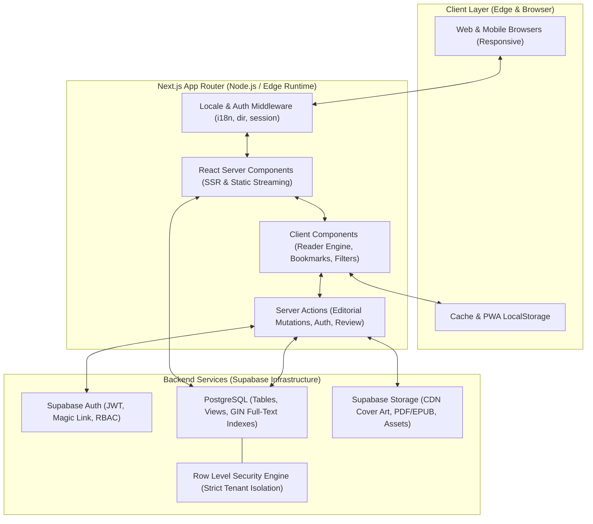
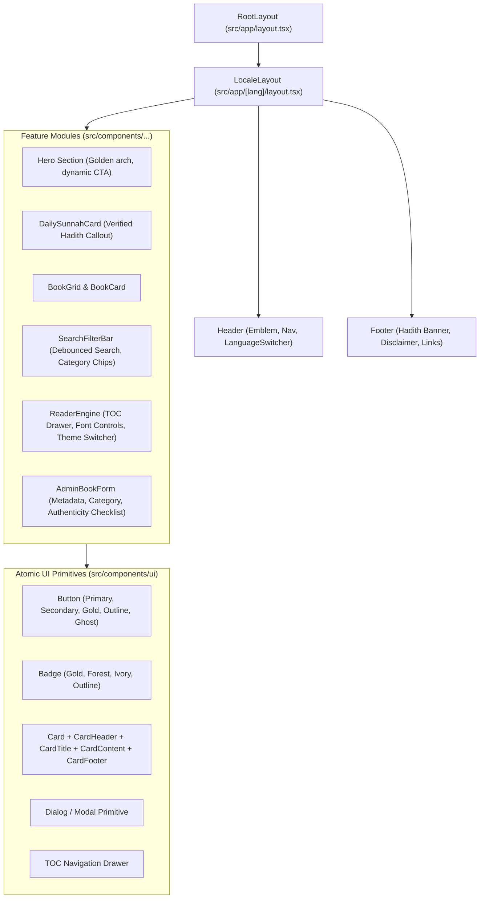
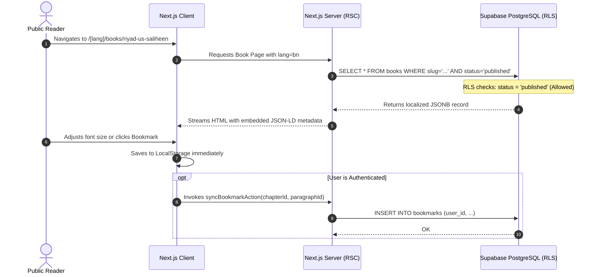
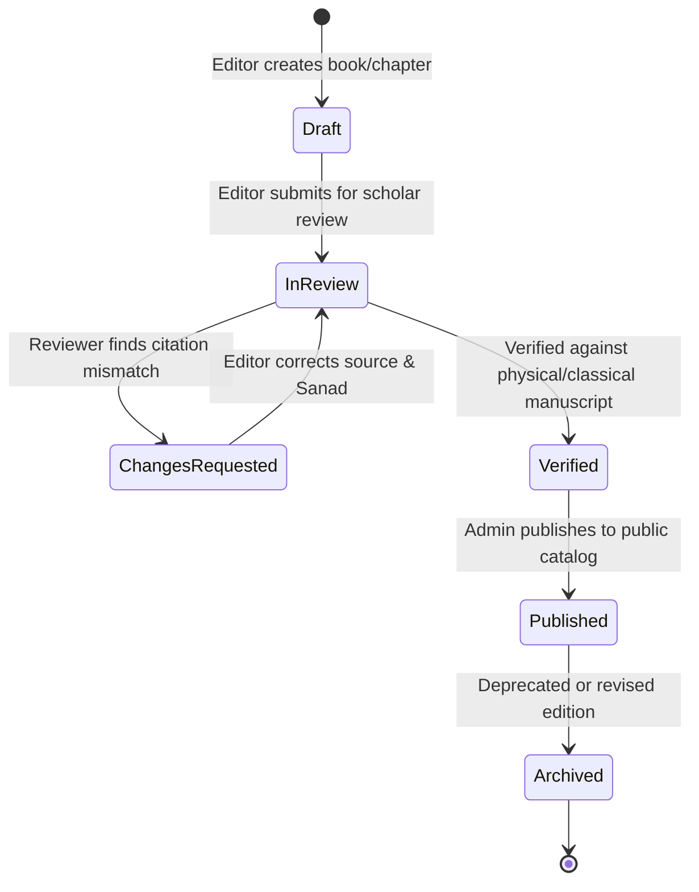

# Protidiner Sunnah (প্রতিদিনের সুন্নাহ)
## Technical Architecture Specification

> **Brand:** প্রতিদিনের সুন্নাহ (Daily Sunnah)  
> **Tagline:** রাসুলুল্লাহ ﷺ-এর আদর্শে প্রতিদিন (Daily in the footsteps of the Messenger ﷺ)  
> **Mission:** Authentic, accessible, and free Islamic educational literature across Bengali, Arabic, and English.  
> **Target Audience:** General readers of all ages worldwide.

---

## 1. Executive Summary & Architectural Principles

"Protidiner Sunnah" is engineered as an open-access Islamic digital library and high-performance online HTML ebook reader. The platform prioritizes:
1. **Absolute Content Authenticity**: Zero compromise on Quranic and Hadith integrity; mandatory scholar/editor verification before publication.
2. **First-Class Multilingual & Bi-directional Support**: Bengali (`bn`, primary), Arabic (`ar`, RTL), and English (`en`, LTR) integrated deeply into layout engines, typography, and database records.
3. **Immersive Reader Experience**: Distraction-free HTML reader with customizable typography, dark/sepia/ivory themes, instant paragraph bookmarking, and offline-resilient progress sync.
4. **Security & Data Isolation**: Enterprise-grade Row-Level Security (RLS) in Supabase PostgreSQL, zero public exposure of service keys, and strict Role-Based Access Control (RBAC).

---

## 2. High-Level Architecture Overview



---

## 3. Next.js Application Architecture

### 3.1 App Router Paradigm
The application leverages Next.js 14+ App Router with React Server Components (RSC) by default to deliver near-zero client bundle sizes for content-heavy pages:
* **Server Components (`RSC`)**: Used for page layouts, static marketing sections, book listings, chapter content rendering, metadata generation, and sitemaps.
* **Client Components (`'use client'`)**: Isolated strictly to interactive surfaces:
  * Ebook Reader Engine (typography controls, reader theme toggles, scroll trackers)
  * Interactive Search & Instant Filtering
  * Bookmark Toggle and Annotation Modals
  * Admin WYSIWYG Chapter Editor
  * Language and Theme Pickers

### 3.2 State Management Strategy
1. **Server State**: Managed via Next.js RSC fetch caching, tag revalidation (`revalidateTag`), and Server Actions.
2. **URL as Source of Truth**: Search queries, category filters, and active chapter pagination are reflected in query parameters and route segments (`/[lang]/library?category=hadith&q=bukhari`).
3. **Local Ephemeral State**: React hooks (`useState`, `useReducer`) for reader UI adjustments (font size, line height).
4. **Persistent Client State**: `localStorage` as an immediate, anonymous fallback for bookmarks and reading progress, asynchronously synchronized with Supabase for authenticated accounts.

---

## 4. Frontend Component & UI/UX Architecture

### 4.1 Design System & Palette Tokens
A refined modern Islamic visual language:
* **Forest Green (`#123F35`)**: Anchor brand color, header surfaces, primary CTA buttons.
* **Deep Green (`#1B5547`)**: Hero gradients, card headers, active navigation accents.
* **Soft Gold (`#D9BD7A`)**: Decorative border trimmings, bookmark indicators, verified badges, ayah callouts.
* **Ivory (`#F7F1E5`)**: Default page canvas and paper reading surface.
* **Charcoal (`#26332F`)**: High-contrast body typography, dark mode base canvas.

### 4.2 Component Hierarchy



---

## 5. Backend Architecture & Data Flow

The backend logic resides within Next.js Server Components, Server Actions, and Supabase PostgreSQL:



---

## 6. Multilingual Content Architecture (i18n & RTL/LTR)

### 6.1 Routing & Detection
* Root requests (`/`) are inspected by [`src/middleware.ts`](file:///d:/Ebook/src/middleware.ts) and automatically routed to `/[lang]/` based on preferred browser header or default locale (`bn`).
* URL structure enforces explicit locale scoping:
  * Bengali: `/bn/...`
  * Arabic: `/ar/...`
  * English: `/en/...`

### 6.2 Dual-Layer Localization
1. **Static UI Dictionaries**: Stored in JSON catalogs (`src/lib/i18n/dictionaries/{bn,ar,en}.json`) loaded lazily on the server via [`getDictionary(locale)`](file:///d:/Ebook/src/lib/i18n/get-dictionary.ts).
2. **Dynamic Database Content**: All user-facing book and category strings use PostgreSQL `jsonb` structures:
   ```json
   {
     "bn": "রিয়াদুস সলেহিন",
     "ar": "رياض الصالحين",
     "en": "Riyad us-Saliheen"
   }
   ```
   This guarantees that adding future languages or editing translations never requires table migrations.

### 6.3 Bidirectional Layout Engine (RTL / LTR)
* `ar` sets `dir="rtl"` on `<html>` and applies Amiri / Noto Naskh Arabic typography.
* `bn` and `en` set `dir="ltr"` and apply Hind Siliguri / Inter typography.
* CSS rules leverage Tailwind logical properties (`ms-`, `me-`, `ps-`, `pe-`, `start-`, `end-`) ensuring margins, paddings, and absolute positioning mirror automatically without layout breakage.

---

## 7. HTML Ebook Reader Engine Architecture

```mermaid
graph LR
    subgraph ReaderState["Reader Controller State"]
        FontSize["Font Size (14px - 28px)"]
        LineHeight["Line Height (1.6 - 2.4)"]
        Theme["Theme Mode (Ivory | Sepia | Charcoal)"]
        ActiveChapter["Active Chapter Index"]
        Progress["Scroll Progress (0% - 100%)"]
    end

    subgraph DOMView["DOM View Layer"]
        TOC["Slide-over Table of Contents Drawer"]
        ReadingCanvas["Reading Canvas (Sanitized Semantic HTML)"]
        StickyToolbar["Floating / Sticky Control Toolbar"]
        ProgressBar["Top Progress Indicator Bar"]
    end

    subgraph StorageLayer["Persistence Layer"]
        LS["Browser LocalStorage (Offline / Guest)"]
        Cloud["Supabase reading_progress Table (Logged-in)"]
    end

    ReaderState --> DOMView
    DOMView --> StorageLayer
```



### 7.1 Reading Canvas Features
1. **Sanitized HTML Rendering**: Chapters are stored as semantic HTML (`<p>`, `<h2>`, `<blockquote class="hadith-box">`, `<span class="arabic-text">`). Content is sanitized via a strict allow-list to prevent XSS.
2. **Three Color Themes**:
   * **Ivory Canvas (`theme-ivory`)**: Warm paper tone (`#F7F1E5`) with deep forest/charcoal text for natural daylight reading.
   * **Sepia Parchment (`theme-sepia`)**: Soft amber tone (`#F2E8D5`) with warm brown text (`#3B2E24`) for relaxed reading.
   * **Charcoal Night (`theme-charcoal`)**: Deep slate canvas (`#18211E`) with soft ivory text (`#EAE3D2`) for zero eye strain in dark environments.
3. **Paragraph Anchoring & Deep Links**: Every paragraph receives an ID (`p-1`, `p-2`) allowing precise sharing and bookmarking.

---

## 8. Admin CMS & Editorial Verification Workflow

To fulfill the strict requirement that **no unverified religious text or AI hallucination is ever published**, the platform enforces a multi-tier publishing workflow:



### 8.1 Verification Audit Fields
Every book and chapter must contain:
* `source_reference`: Specific edition, volume, and page of original printed work (e.g., *Sahih al-Bukhari, Darussalam 2000, Hadith #1*).
* `authenticity_notes`: Scholars' consensus or verification grade (Sahih, Hasan, Mutawatir).
* `verified_by`: Reference to the scholar/admin UUID who conducted the audit.

---

## 9. Authentication, Authorization & RLS Strategy

### 9.1 User Roles
* **Reader (Default)**: Public browsing, private bookmarking, private reading progress tracking.
* **Editor**: Create and edit draft books, categories, and chapters. Cannot unilaterally publish live.
* **Admin**: Manage user roles, approve/verify books, publish to the public catalog, view audit logs.

### 9.2 Row Level Security (RLS) Policy Summary
* `books` & `chapters`: Public users can only `SELECT` records where `status = 'published'`. Staff can view and edit according to role.
* `bookmarks` & `reading_progress`: Users can only `SELECT`, `INSERT`, `UPDATE`, `DELETE` their own rows (`auth.uid() = user_id`).
* `profiles`: Users can only edit their own profile; public can read basic info; role changes restricted to service role or database function.

---

## 10. SEO, Accessibility & Performance Strategy

### 10.1 Structured Data (JSON-LD)
Pages dynamically inject Schema.org structured metadata:
* **`Book` Schema**: ISBN, author, title, inLanguage, publisher, description.
* **`Chapter` / `Article` Schema**: headline, articleBody snippet, wordCount.
* **`Organization` & `WebSite` Schema**: Search action deep-linking.

### 10.2 OpenGraph & Twitter Cards
* Localized social share cards with dynamic title, description, and high-resolution cover preview.

### 10.3 Accessibility (a11y)
* Semantic landmarks (`<header>`, `<nav>`, `<main>`, `<article>`, `<footer>`).
* ARIA attributes for drawers, dropdowns, and font controls (`aria-expanded`, `aria-label`).
* High contrast ratio adhering to WCAG 2.1 AA (tested on Forest Green over Ivory and Gold accents).
